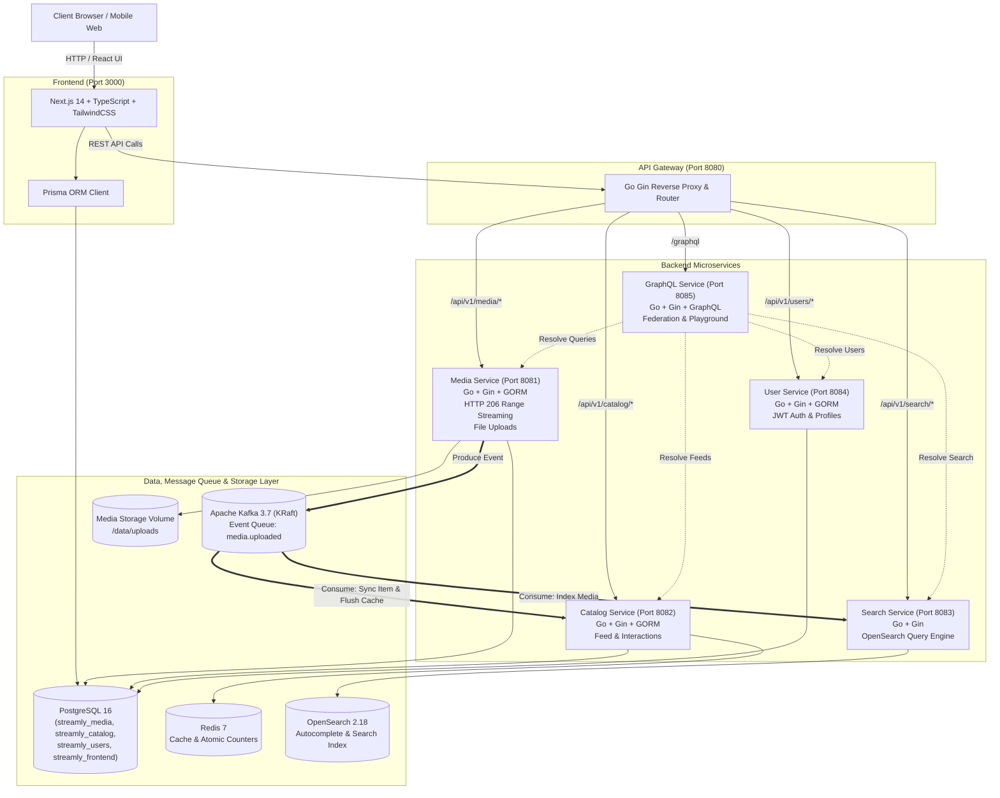

# Streamly 🚀

> **Streamly** is a cloud-native microservice streaming platform for **Videos**, **Shorts**, and **Music**. Built with **Next.js + TypeScript + TailwindCSS + Prisma + PostgreSQL** for the UI, and **Go (Golang) + Gin + GORM + PostgreSQL** for backend microservices, backed by **Redis** for caching and **OpenSearch** for full-text search and real-time autocomplete suggestions.

---

## 🌟 Key Features

- 🎬 **Video Streaming**: 16:9 player with **HTTP 206 Partial Content (Range requests)** for smooth seeking and buffering. Includes view counters, likes/dislikes, comments, and related video suggestions.
- 📱 **Shorts & Reels**: Vertical 9:16 feed with sound credits, like counter, and swipe/keyboard navigation.
- 🎵 **Music Streaming**: High-fidelity audio playback with a **persistent global player bar** that continues playing across pages, with seek bar, volume control, track queue, and album artwork.
- 📤 **Upload Studio**: Unified upload interface supporting Videos, Shorts, and Music tracks (MP4, WebM, MOV, MP3, WAV, FLAC) with custom thumbnail preview, metadata, tags, and real-time upload progress.
- 🔍 **OpenSearch Integration**: Lightning-fast search with **edge n-gram autocomplete suggestions** as you type and multi-field fuzzy matching across titles, artists, descriptions, and tags.
- ⚡ **Redis High-Performance Caching**: Caching trending feeds, recent uploads, and atomic view counters.
- 🛡️ **Microservices Architecture**: True **Database-per-Service** isolation across PostgreSQL databases.
- 🐳 **Docker & Docker Compose**: Every service is containerized with its own multi-stage `Dockerfile`, orchestrated via a single root `docker-compose.yml`.

---

## 🏗️ Architecture Overview



---

## 📁 Project Structure

```
Streamly/
├── docker-compose.yml           # Unified orchestration for all services and databases
├── .env.example                 # Template environment variables
├── .env                         # Active configuration
├── README.md                    # Project documentation
├── scripts/
│   ├── init-db.sql              # Auto-creates isolated databases per microservice
│   └── seed-data.sh             # Seeds sample videos, shorts, and music
├── services/
│   ├── api-gateway/             # Go + Gin Reverse Proxy & Router (Port 8080)
│   │   ├── Dockerfile
│   │   ├── go.mod
│   │   └── main.go
│   ├── media-service/           # Go + Gin + GORM + Range Streamer (Port 8081)
│   │   ├── Dockerfile
│   │   ├── go.mod
│   │   ├── config/
│   │   ├── controllers/         # Upload, Stream (HTTP 206), Media CRUD
│   │   ├── models/              # Media model
│   │   └── routes/
│   ├── catalog-service/         # Go + Gin + GORM + Redis (Port 8082)
│   │   ├── Dockerfile
│   │   ├── go.mod
│   │   ├── cache/               # Redis feed cache & view counter
│   │   ├── controllers/         # Feed, Trending, Likes, Comments
│   │   ├── models/              # CatalogItem, Comment, MediaLike
│   │   └── routes/
│   ├── search-service/          # Go + Gin + OpenSearch (Port 8083)
│   │   ├── Dockerfile
│   │   ├── go.mod
│   │   ├── opensearch/          # OpenSearch client with edge n-gram analyzer
│   │   ├── controllers/         # Search, Suggest, Index, Reindex
│   │   └── routes/
│   └── user-service/            # Go + Gin + GORM (Port 8084)
│       ├── Dockerfile
│       ├── go.mod
│       ├── controllers/         # Auth (JWT) & Channel profile
│       ├── middleware/          # JWT verification middleware
│       ├── models/              # User model
│       └── routes/
└── frontend/                    # Next.js 14 + TypeScript + TailwindCSS + Prisma (Port 3000)
    ├── Dockerfile
    ├── package.json
    ├── tailwind.config.ts
    ├── next.config.mjs
    ├── prisma/
    │   └── schema.prisma        # Frontend user sessions, history & playlists
    └── src/
        ├── app/
        │   ├── page.tsx         # Home feed (Videos, Shorts, Music)
        │   ├── watch/[id]/      # Video player page with comments & up-next
        │   ├── shorts/          # Vertical reels/shorts viewer
        │   ├── music/           # Dedicated Music Hub
        │   ├── upload/          # Upload Studio (Video, Short, Music)
        │   └── search/          # OpenSearch results page
        ├── components/          # Navbar, Sidebar, PlayerBar, Cards, Comments
        ├── context/             # Global AudioPlayerContext
        └── lib/                 # API Gateway client & Prisma instance
```

---

## 🚀 Quick Start with Docker Compose

Ensure [Docker](https://www.docker.com/) and Docker Compose are installed.

### 1. Clone & Enter Project Directory
```bash
cd Streamly
```

### 2. Launch All Services
```bash
docker compose up --build -d
```

This starts:
- **Frontend** at [http://localhost:3000](http://localhost:3000)
- **API Gateway & Swagger UI** at [http://localhost:8080/docs](http://localhost:8080/docs)
- **OpenAPI 3.0 Spec** at [http://localhost:8080/openapi.json](http://localhost:8080/openapi.json)
- **Media Service** at [http://localhost:8081](http://localhost:8081)
- **Catalog Service** at [http://localhost:8082](http://localhost:8082)
- **Search Service** at [http://localhost:8083](http://localhost:8083)
- **User Service** at [http://localhost:8084](http://localhost:8084)
- **OpenSearch** at [http://localhost:9200](http://localhost:9200)
- **PostgreSQL** at `localhost:5432`
- **Redis** at `localhost:6379`

### 3. Seed Sample Content (Optional)
To instantly populate the platform with sample videos, shorts, and music tracks:
```bash
./scripts/seed-data.sh
```

Then visit [http://localhost:3000](http://localhost:3000) to start watching and listening!

---

## 📖 Interactive Swagger API Documentation

Streamly comes with built-in interactive Swagger UI served directly by the API Gateway:

- **Interactive Swagger UI**: [http://localhost:8080/docs](http://localhost:8080/docs) (or [http://localhost:8080/swagger](http://localhost:8080/swagger))
- **OpenAPI 3.0 Specification (JSON)**: [docs/openapi.json](file:///Users/apple/Workspace/Streamly/docs/openapi.json) or [http://localhost:8080/openapi.json](http://localhost:8080/openapi.json)
- **OpenAPI 3.0 Specification (YAML)**: [docs/openapi.yaml](file:///Users/apple/Workspace/Streamly/docs/openapi.yaml)

From the Swagger UI, you can inspect schemas, request models, response headers (such as `Content-Range`), authentication parameters, and test API calls live using the **"Try it out"** button.

---

## ⚡ Interactive GraphQL Playground & API

Streamly includes a dedicated **Go GraphQL Service** running on port `8085` and proxied through `http://localhost:8080/graphql`.

- **Comprehensive GraphQL Guide**: [docs/GRAPHQL.md](file:///Users/apple/Workspace/Streamly/docs/GRAPHQL.md)
- **GraphQL Schema SDL**: [docs/schema.graphql](file:///Users/apple/Workspace/Streamly/docs/schema.graphql)
- **GraphQL Playground**: [http://localhost:8080/graphql](http://localhost:8080/graphql) (or direct: [http://localhost:8085/graphql](http://localhost:8085/graphql))
- **GraphQL HTTP Endpoint**: `POST http://localhost:8080/graphql`

### Example Query: Fetch Media with Nested Uploader Profile & Comments
```graphql
query GetMediaDetails {
  media(id: "c1a9320e-6f81-4f11-9a40-3b4781423851") {
    id
    title
    description
    media_type
    views
    likes
    stream_url
    thumbnail_url
    uploader {
      id
      username
      display_name
      avatar_url
      subscribers
    }
    comments {
      id
      user_name
      content
      created_at
    }
  }
}
```

### Example Query: Search with Autocomplete Suggestions
```graphql
query SearchAndSuggest {
  search(query: "cyberpunk", type: ALL, limit: 5) {
    total
    took
    items {
      id
      title
      media_type
      artist
      duration
    }
  }
  suggestions(query: "neon", limit: 3)
}
```

### Example Mutation: Post Comment & Like
```graphql
mutation AddNewComment {
  addComment(
    mediaId: "c1a9320e-6f81-4f11-9a40-3b4781423851"
    content: "Mind-blowing 4K visual quality!"
    userName: "Alex Rivera"
  ) {
    id
    content
    user_name
    created_at
  }
  toggleLike(
    mediaId: "c1a9320e-6f81-4f11-9a40-3b4781423851"
    userId: "user_abc123"
  ) {
    liked
  }
}
```

---

## 🚀 gRPC Inter-Service Communication (East-West Traffic)

Streamly uses **gRPC (HTTP/2 + Protocol Buffers)** for high-throughput, low-latency inter-service communication:

- **Comprehensive gRPC Guide**: [docs/GRPC.md](file:///Users/apple/Workspace/Streamly/docs/GRPC.md)
- **Protocol Buffer Definitions**:
  - Media: [proto/media/media.proto](file:///Users/apple/Workspace/Streamly/proto/media/media.proto) (`:50051`)
  - Catalog: [proto/catalog/catalog.proto](file:///Users/apple/Workspace/Streamly/proto/catalog/catalog.proto) (`:50052`)
  - Search: [proto/search/search.proto](file:///Users/apple/Workspace/Streamly/proto/search/search.proto) (`:50053`)
  - User: [proto/user/user.proto](file:///Users/apple/Workspace/Streamly/proto/user/user.proto) (`:50054`)

### Dual-Stack Pattern
* **HTTP/REST (8081-8084)**: Used for client-facing operations, multipart video/music file uploads, and RFC 7233 HTTP 206 Partial Content video seeking.
* **gRPC (50051-50054)**: Used for internal service-to-service calls (indexing events, catalog synchronization, user profile resolution, and GraphQL resolver calls).

---

## 📨 Apache Kafka Message Queue (Event-Driven Backbone)

Streamly integrates **Apache Kafka (KRaft mode)** on port `9092` for reliable, decoupled event distribution:

- **Comprehensive Kafka Guide**: [docs/KAFKA.md](file:///Users/apple/Workspace/Streamly/docs/KAFKA.md)
- **Primary Topic**: `media.uploaded` (partitioned by `media_id`)
- **Producer**: [services/media-service/kafka/producer.go](file:///Users/apple/Workspace/Streamly/services/media-service/kafka/producer.go)
- **Consumer 1**: [services/search-service/kafka/consumer.go](file:///Users/apple/Workspace/Streamly/services/search-service/kafka/consumer.go) (`search-service-indexer` group)
- **Consumer 2**: [services/catalog-service/kafka/consumer.go](file:///Users/apple/Workspace/Streamly/services/catalog-service/kafka/consumer.go) (`catalog-service-syncer` group)

---

## 📡 API Reference (via API Gateway :8080)

| Service | Method | Endpoint | Description |
| :--- | :--- | :--- | :--- |
| **Media** | `POST` | `/api/v1/media/upload` | Multipart upload (video/short/music + thumbnail) |
| **Media** | `GET` | `/api/v1/media/stream/:id` | HTTP 206 partial content audio/video streaming |
| **Media** | `GET` | `/api/v1/media/stream/:id/thumbnail` | Serves media thumbnail image |
| **Catalog** | `GET` | `/api/v1/catalog/feed?type=...` | Feed list (cached in Redis) |
| **Catalog** | `GET` | `/api/v1/catalog/trending` | Trending media list |
| **Catalog** | `POST` | `/api/v1/catalog/media/:id/view` | Increments view counter |
| **Catalog** | `POST` | `/api/v1/catalog/media/:id/like` | Toggle like/unlike |
| **Catalog** | `GET` | `/api/v1/catalog/media/:id/comments` | List comments |
| **Catalog** | `POST` | `/api/v1/catalog/media/:id/comments` | Add comment |
| **Search** | `GET` | `/api/v1/search?q=...&type=...` | OpenSearch multi-field search |
| **Search** | `GET` | `/api/v1/search/suggest?q=...` | Edge n-gram autocomplete suggestions |
| **Search** | `POST` | `/api/v1/search/reindex` | Full catalog re-indexing |
| **User** | `POST` | `/api/v1/auth/register` | User signup |
| **User** | `POST` | `/api/v1/auth/login` | User login (returns JWT) |
| **User** | `GET` | `/api/v1/users/:id` | Public channel profile |

---

## 🛠️ Local Development Without Docker

### Run Backend Microservices
Each service can be run locally using standard Go:
```bash
# Media Service
cd services/media-service
go run main.go

# Catalog Service
cd services/catalog-service
go run main.go

# Search Service
cd services/search-service
go run main.go

# User Service
cd services/user-service
go run main.go

# API Gateway
cd services/api-gateway
go run main.go
```

### Run Frontend
```bash
cd frontend
npm install
npx prisma generate
npm run dev
```

Visit [http://localhost:3000](http://localhost:3000).

---

## 📄 License
MIT License. Built for modern, high-performance streaming.
