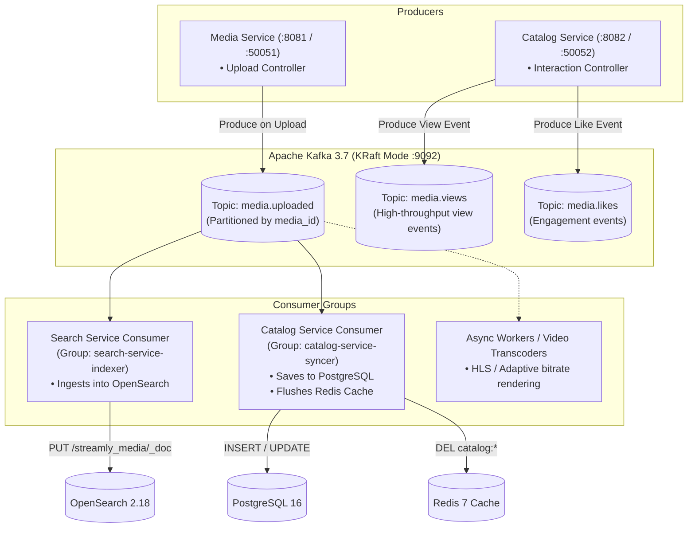

# Streamly Apache Kafka Event-Driven Message Queue 📨

Streamly utilizes **Apache Kafka (KRaft mode)** as its distributed, event-driven streaming backbone to decouple microservices and provide asynchronous, reliable message queuing.

---

## 🏛️ Event-Driven Architecture Overview



---

## 📊 Kafka Topics & Specifications

### 1. `media.uploaded`
Broadcasted whenever a new video, short reel, or audio song is uploaded and saved to storage.

- **Brokers**: `kafka:9092`
- **Key**: `media.id` (UUID string)
- **Producer**: [services/media-service/kafka/producer.go](file:///Users/apple/Workspace/Streamly/services/media-service/kafka/producer.go)
- **Consumers**:
  - `search-service-indexer`: Consumes message and triggers OpenSearch index mapping ([services/search-service/kafka/consumer.go](file:///Users/apple/Workspace/Streamly/services/search-service/kafka/consumer.go))
  - `catalog-service-syncer`: Consumes message, inserts record into `streamly_catalog` DB, and flushes `catalog:*` cache in Redis ([services/catalog-service/kafka/consumer.go](file:///Users/apple/Workspace/Streamly/services/catalog-service/kafka/consumer.go))

#### Payload Schema
```json
{
  "id": "c1a9320e-6f81-4f11-9a40-3b4781423851",
  "title": "Big Buck Bunny - 4K Animated Film",
  "description": "The classic open-source 4K animation.",
  "media_type": "video",
  "artist": "Blender Foundation",
  "duration": 596.0,
  "stream_url": "/api/media/stream/c1a9320e-6f81-4f11-9a40-3b4781423851",
  "thumbnail_url": "/api/media/stream/c1a9320e-6f81-4f11-9a40-3b4781423851/thumbnail",
  "uploader_id": "usr_998127391",
  "uploader_name": "Blender Foundation",
  "tags": "animation,4k,blender,movie",
  "created_at": "2026-11-14T04:20:00Z"
}
```

---

## 🛠️ Inspecting Kafka in Docker

You can use the built-in Kafka scripts inside the `streamly-kafka` container to list topics or stream real-time events:

### 1. List All Topics
```bash
docker exec -it streamly-kafka /opt/kafka/bin/kafka-topics.sh \
  --bootstrap-server localhost:9092 \
  --list
```

### 2. Stream Real-Time Messages from `media.uploaded`
```bash
docker exec -it streamly-kafka /opt/kafka/bin/kafka-console-consumer.sh \
  --bootstrap-server localhost:9092 \
  --topic media.uploaded \
  --from-beginning
```

### 3. Describe Consumer Groups
```bash
docker exec -it streamly-kafka /opt/kafka/bin/kafka-consumer-groups.sh \
  --bootstrap-server localhost:9092 \
  --describe --group search-service-indexer
```

---

## ⚙️ Resilience & Delivery Semantics

- **Pure Go Driver (`segmentio/kafka-go`)**: Eliminates the need for dynamic CGo/librdkafka linking, ensuring fast, cross-platform compilation in multi-stage Alpine Docker images.
- **Consumer Group Offset Management**: Each consumer maintains its own committed offset in `__consumer_offsets`. If `search-service` or `catalog-service` restarts, it resumes consuming exactly where it left off.
- **Non-blocking Producers**: Upload controllers publish events asynchronously with zero blocking overhead on HTTP response latency.
